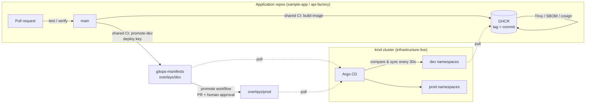

# GitOps Platform Blueprint

Blueprint and shared building blocks for application delivery where **Git is the single source of truth**.
The reference implementation currently runs end to end on a **local kind cluster**; GKE / Terraform are the parts
designed to be swapped in later without changing the delivery flow.

## Architecture



| Repository | Responsibility | Contents |
|---|---|---|
| **gitops-platform-blueprint** (this repo) | Architecture + **shared CI** (reusable workflows) | `build-image.yml`, `promote-dev.yml` |
| [infrastructure-live](https://github.com/MIERAI/infrastructure-live) | Platform: cluster, Argo CD, runtime secrets | kind config, pinned Argo CD, root app, `scripts/up.sh` |
| [gitops-manifests](https://github.com/MIERAI/gitops-manifests) | Desired state: apps × environments | Kustomize base/overlays, Argo CD Applications, `promote` workflow |
| [sample-app](https://github.com/MIERAI/sample-app) | Public reference application | Minimal Go HTTP service + CI |
| api-factory (private) | Real workload: APIs generated by a spec-driven API factory | Verification (acceptance tests on 3 seeds + mutation margin) → the same shared CI |

## Delivery flow

1. **Pull request** in an app repo: tests (for api-factory: acceptance tests on 3 seeds plus mutation testing).
2. **Merge to main**: the image is **built once** (tag = commit) → GHCR → Trivy (fails on fixable CRITICAL) → SBOM → cosign keyless signature (public repos).
3. CI updates the tag in `gitops-manifests/<app>/overlays/dev`, using a deploy key that can write to that repository only.
4. **Argo CD** detects the drift and syncs dev: ordered by sync waves → Sync hooks (api-factory: schema Job) → rolling update (the old version keeps serving until the new one is healthy) → PostSync smoke Job.
5. **Production**: the `promote` workflow in gitops-manifests opens a PR that copies the version running in dev to prod → a human approves and merges → Argo CD syncs.
6. **Rollback**: `git revert` in gitops-manifests → Argo CD syncs back. Nobody touches the cluster directly.

## Shared CI (reusable workflows)

```yaml
jobs:
  image:
    permissions: { contents: read, packages: write, id-token: write }
    uses: MIERAI/gitops-platform-blueprint/.github/workflows/build-image.yml@main
    with: { image: sample-app, sign: true }
  promote:
    needs: image
    uses: MIERAI/gitops-platform-blueprint/.github/workflows/promote-dev.yml@main
    with: { app: sample-app, images: "ghcr.io/mierai/sample-app=${{ needs.image.outputs.tag }}" }
    secrets: { MANIFESTS_DEPLOY_KEY: "${{ secrets.MANIFESTS_DEPLOY_KEY }}" }
```

- `build-image`: buildx with the GitHub Actions cache → GHCR (`<short sha>` and `main`) → Trivy → SBOM artifact → optional cosign keyless signing
  (signatures go to the public transparency log, which reveals the repository name, so signing is off by default for private repos).
- `promote-dev`: updates only the image tag via `gitops-manifests/scripts/set-image.sh`; retries when several apps push at the same time.

## Design principles

1. **Git is the single source of truth.** Manual changes in the cluster are reverted by Argo CD self-heal; every change and rollback is a commit.
2. **Separation of concerns.** Platform (infrastructure-live), desired state (gitops-manifests) and applications have independent lifecycles.
3. **Build once.** Images are never rebuilt per environment: prod runs exactly the tag verified in dev.
4. **No secrets in Git.** Manifests only reference secrets (`secretKeyRef`); values are created by the platform (locally `scripts/secrets.sh`; on GKE, Secret Manager + External Secrets).
5. **Least privilege.** CI → gitops-manifests via a repo-scoped deploy key; images via `GITHUB_TOKEN`; cloud access via Workload Identity Federation once on GKE.

## Run it locally

```sh
git clone https://github.com/MIERAI/infrastructure-live && cd infrastructure-live
scripts/up.sh                                # kind + Argo CD + secrets + root app; everything else comes from gitops-manifests
kubectl get applications -n argocd
curl -s 'localhost:18082/hello?name=gitops'  # sample-app (dev)
scripts/down.sh
```

## Roadmap

- GKE: Terraform in infrastructure-live (VPC, GKE, Cloud SQL, Workload Identity) replacing the kind part
- Progressive delivery: Argo Rollouts (canary + metric analysis + automatic rollback)
- Signature verification in the cluster (Kyverno / sigstore policy-controller)
- Secrets: External Secrets Operator

---
Status: the local (kind) reference implementation works end to end. GKE is not started yet.
