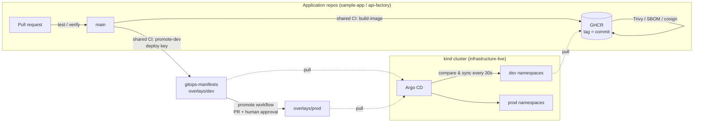

# GitOps Platform Blueprint

Blueprint and shared building blocks for application delivery where **Git is the single source of truth**.
The reference implementation currently runs end to end on a **local kind cluster**; GKE / Terraform are the parts
designed to be swapped in later without changing the delivery flow.

## Architecture



| Repository | Responsibility | Contents |
|---|---|---|
| **gitops-platform-blueprint** (this repo) | Architecture + **shared CI** (reusable workflows) | `build-image.yml`, `promote-dev.yml` |
| [infrastructure-live](https://github.com/MIERAI/infrastructure-live) | Platform: hosts, clusters, Argo CD, runtime secrets | OpenTofu (`tofu/`: clusters + Argo CD + secrets + root app), Ansible (`ansible/`: hosts), SOPS-encrypted secrets |
| [gitops-manifests](https://github.com/MIERAI/gitops-manifests) | Desired state: apps × environments | One directory per application (`app.yaml` + kustomize / Helm), an ApplicationSet, admission policies, `promote` workflow |
| [sample-app](https://github.com/MIERAI/sample-app) | Public reference application | Minimal Go HTTP service + CI |
| [storefront](https://github.com/MIERAI/storefront) | Monorepo reference application | Three services (kustomize + Helm) released and promoted on their own, dev → staging → prod |
| delivery-board (private) | Every change from PR to prod, promotion gates | Go; pipelines discovered from the `app.yaml` files |
| api-factory (private) | Real workload: APIs generated by a spec-driven API factory | Verification (acceptance tests on 3 seeds + mutation margin) → the same shared CI |

## Try it yourself

The whole platform on your machine in ~5 minutes, without any of our keys, tokens or accounts (Docker, OpenTofu,
kubectl): [infrastructure-live `tofu/demo`](https://github.com/MIERAI/infrastructure-live/tree/main/tofu/demo).
CI runs exactly that on every change and every week, and requires every application healthy.

## Add an application

A directory in gitops-manifests with an `app.yaml` (example: `storefront/app.yaml`) and the application's manifests;
its CI calls the shared workflows. Nothing else: the Argo CD Applications, namespaces and their labels (admission
policies, image signatures, the pull secret cloned by Kyverno), promotions and the delivery board all follow from
`app.yaml`. Removing it = removing the directory.

## Delivery flow

1. **Pull request** in an app repo: tests (for api-factory: acceptance tests on 3 seeds plus mutation testing).
2. **Merge to main**: the image is **built once** (tag = commit) → GHCR → Trivy (fails on fixable CRITICAL) → SBOM → cosign keyless signature (public repos).
3. CI updates the tag in dev (the file `gitops-manifests/<app>/app.yaml` points to: a kustomize overlay or Helm values),
   using a deploy key that can write to that repository only.
4. **Argo CD** detects the drift and syncs dev: ordered by sync waves → init containers (api-factory: goose migrations) → rolling update (the old version keeps serving until the new one is healthy) → PostSync smoke Job.
5. **Production**: the `promote` workflow in gitops-manifests opens a PR that copies the version running in dev to prod → a human approves and merges → Argo CD syncs.
6. **Rollback**: `git revert` in gitops-manifests → Argo CD syncs back. Nobody touches the cluster directly.

## Shared CI (reusable workflows)

```yaml
jobs:
  image:
    permissions: { contents: read, packages: write, id-token: write }
    uses: MIERAI/gitops-platform-blueprint/.github/workflows/build-image.yml@main
    with: { image: sample-app, sign: true }
  promote:
    needs: image
    uses: MIERAI/gitops-platform-blueprint/.github/workflows/promote-dev.yml@main
    with: { app: sample-app, images: "ghcr.io/mierai/sample-app=${{ needs.image.outputs.tag }}" }
    secrets: { MANIFESTS_DEPLOY_KEY: "${{ secrets.MANIFESTS_DEPLOY_KEY }}" }
```

- `build-image`: buildx with the GitHub Actions cache → GHCR (`<short sha>` and `main`) → Trivy → SBOM artifact → optional cosign keyless signing
  (signatures go to the public transparency log, which reveals the repository name, so signing is off by default for private repos).
- `promote-dev`: updates only the image tag via `gitops-manifests/scripts/set-image.sh`; retries when several apps push at the same time.

## Shipping a change

`main` is protected in every repository (pull request + required checks). `scripts/ship.sh "<title>"` turns the
commits on local `main` into a PR with auto-merge, waits until it is merged and syncs local `main`. It refuses to run
with uncommitted changes or when there is nothing to ship.

## Design principles

1. **Git is the single source of truth.** Manual changes in the cluster are reverted by Argo CD self-heal; every change and rollback is a commit.
2. **Separation of concerns.** Platform (infrastructure-live), desired state (gitops-manifests) and applications have independent lifecycles.
3. **Build once.** Images are never rebuilt per environment: prod runs exactly the tag verified in dev.
4. **No secrets in Git.** Manifests only reference secrets (`secretKeyRef`); values live SOPS/age-encrypted in infrastructure-live and are applied by OpenTofu (on GKE: Secret Manager + External Secrets).
5. **Least privilege.** CI → gitops-manifests via a repo-scoped deploy key; images via `GITHUB_TOKEN`; cloud access via Workload Identity Federation once on GKE.

## Run it locally

```sh
git clone https://github.com/MIERAI/infrastructure-live && cd infrastructure-live
export TF_VAR_ghcr_token=$(gh auth token)   # GHCR pull secret (read:packages)
tofu -chdir=tofu/kind init && tofu -chdir=tofu/kind apply   # kind + Argo CD + secrets + root app; the rest comes from gitops-manifests
scripts/wait-synced.sh --healthy
curl -s 'localhost:18082/hello?name=gitops'  # sample-app (dev)
tofu -chdir=tofu/kind destroy
```

## Clusters

| Cluster | Where | Purpose | Differences (gitops-manifests) |
|---|---|---|---|
| kind | workstation, on demand | experiments, rebuild drills (`rebuild-drill.sh`: whole platform from Git in ~5.5 min) | renders `apps/` |
| laptop | k3s on an always-on Linux laptop (`TARGET=laptop`; host layer: Ansible `infrastructure-live/ansible`, platform: `tofu/laptop`) | the "cloud": runs 24/7 with synthetic traffic; alerts are read out loud by the laptop | `clusters/laptop`: object storage **outside** the cluster (host SeaweedFS on its own disk, backups survive a cluster rebuild), Alertmanager → speaker |

Both clusters follow the same `main` of gitops-manifests. Limits of the laptop as a cloud: one machine (backups are
outside the cluster but on the same host), no managed services, no IAM / Workload Identity, no public ingress.

## Platform (in the cluster)

| Concern | Implementation | Checked by |
|---|---|---|
| Progressive delivery | Argo Rollouts canary + Prometheus analysis (error ratio, p95), automatic abort | fault-injection runs (bad canary aborted in ~30s) |
| Load tests | k6: in the canary analysis of sample-app (100 rps against the canary only; breach → abort), PostSync in api-factory dev (30 rps, per-RPC p95) | lock-contention fault: passed the metric-only canary, aborted in 53s with the load step |
| Observability | kube-prometheus-stack: PodMonitors, SLO burn-rate alerts, Grafana dashboards, synthetic traffic | alerts carry runbook links |
| Data | CloudNativePG (prod: primary + replica), WAL archiving + daily base backups to S3 (Barman Cloud plugin) | `infrastructure-live/scripts/restore-drill.sh` (PITR ~1 min), `failover-drill.sh` (25–49s) |
| Admission policies | Kyverno (CEL): pinned images, resources, readiness probes, non-root; cosign signature of public images (identity: `build-image.yml` on main); reviewed exceptions only from the `kyverno` namespace | policy tests with good/bad fixtures + every overlay checked on the PR (`gitops-manifests/scripts/validate.sh`) |

## Operating it

- [Runbook](docs/runbook.md): one section per alert (linked from each alert's `runbook` annotation), rollback,
  canary aborted, admission denied, database restore, platform rebuild.
- [Lessons learned](docs/lessons.md): every problem hit while building this, with cause and fix.
- Drills (infrastructure-live `scripts/`): `restore-drill.sh` (point-in-time recovery), `failover-drill.sh`
  (primary loss under traffic), `rebuild-drill.sh` (whole platform from Git, timed). UIs: `ui.sh`.

## Roadmap

- GKE: Terraform in infrastructure-live (VPC, GKE, Cloud SQL, Workload Identity) replacing the kind part
- Secrets: External Secrets Operator

---
Status: the local (kind) reference implementation works end to end. GKE is not started yet.
